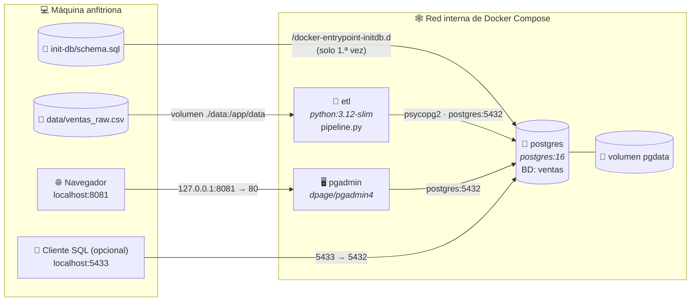
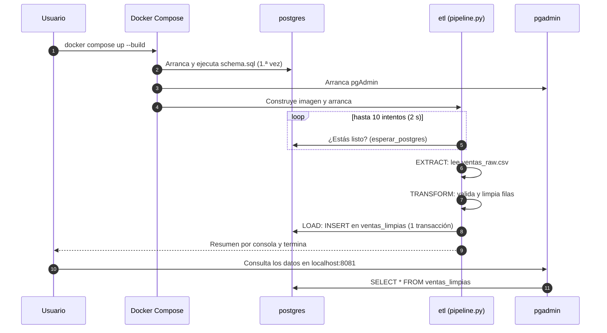

<div align="center">

# Final Project · Docker Big Data Stack

### Pipeline ETL contenerizado: CSV → Python → PostgreSQL → pgAdmin


</div>

---

## 📖 Descripción

Proyecto final que implementa un **pipeline ETL** (*Extract, Transform, Load*) completamente orquestado con **Docker Compose**. Toma un fichero de ventas "sucio" (`ventas_raw.csv`), lo **valida y limpia** con Python y lo **carga** en una base de datos **PostgreSQL**, que se puede explorar visualmente desde **pgAdmin**.

Con un solo comando se levantan tres servicios aislados que se comunican por una red interna de Docker, sin instalar nada en la máquina anfitriona salvo Docker.

## Índice

1. [Arquitectura y contexto teórico](#-arquitectura-y-contexto-teórico)
2. [Estructura del proyecto](#-estructura-del-proyecto)
3. [Los datos](#-los-datos)
4. [El pipeline ETL paso a paso](#-el-pipeline-etl-paso-a-paso)
5. [Servicios Docker](#-servicios-docker)
6. [Puesta en marcha](#-puesta-en-marcha)
7. [Consultar y verificar los resultados](#-consultar-y-verificar-los-resultados)
8. [Variables de entorno](#-variables-de-entorno)
9. [Decisiones de diseño y mejoras futuras](#-decisiones-de-diseño-y-mejoras-futuras)
10. [Autor](#-autor)
11. [Licencia](#-licencia)

---

## Arquitectura y contexto teórico

### ¿Qué es un ETL?

**ETL** es el patrón fundamental de la ingeniería de datos y la base de cualquier stack de Big Data:

| Fase | Qué hace | En este proyecto |
|------|----------|------------------|
| **E**xtract | Lee los datos desde su origen | `leer_csv()` lee `ventas_raw.csv` |
| **T**ransform | Limpia, valida y normaliza | `limpiar_fila()` descarta filas inválidas, unifica fechas, calcula totales |
| **L**oad | Guarda el resultado en el destino | `cargar_en_postgres()` inserta en `ventas_limpias` |

### ¿Por qué Docker y Docker Compose?

- **Docker** empaqueta una aplicación con todas sus dependencias en un *contenedor*: ligero, aislado y reproducible ("funciona en mi máquina" pasa a "funciona en cualquier máquina").
- **Docker Compose** describe en un único fichero (`docker-compose.yml`) un sistema **multi-contenedor**: qué servicios existen, cómo se construyen, qué puertos exponen, qué volúmenes montan y en qué orden arrancan.
- Compose crea automáticamente una **red interna** donde cada servicio es accesible por su **nombre** (DNS interno). Por eso el ETL se conecta con `DB_HOST=postgres` y no con una IP.

### Diagrama de componentes



### Flujo de ejecución



### Cómo se conectan los servicios

| Origen | Destino | Cómo | Para qué |
|--------|---------|------|----------|
| `etl` | `postgres` | Red interna, host `postgres`, puerto `5432`, driver `psycopg2` | Cargar los datos limpios |
| `pgadmin` | `postgres` | Red interna, host `postgres`, puerto `5432` | Administración visual |
| Anfitrión | `postgres` | Puerto publicado `5433 → 5432` | Cliente SQL externo (DBeaver, `psql`…) |
| Anfitrión | `pgadmin` | Puerto publicado `127.0.0.1:8081 → 80` | Interfaz web (solo accesible desde tu propia máquina) |
| Anfitrión | `etl` | Volumen `./data:/app/data` | El CSV se puede editar sin reconstruir la imagen |
| Anfitrión | `postgres` | Volumen `./init-db:/docker-entrypoint-initdb.d` | Crea la tabla automáticamente al inicializar la BD |
| `postgres` | Disco | Volumen con nombre `pgdata` | **Persistencia**: los datos sobreviven a `docker compose down` |

> 💡 **Dos puertos de PostgreSQL, ¿por qué?** Dentro de la red de Docker, PostgreSQL escucha en el `5432`. Hacia fuera se publica en el `5433` para no chocar con una instalación local de PostgreSQL que ya use el `5432`.

---

## Estructura del proyecto

```text
final-proyect-docker-bigdatastack/
│
├── 📄 README.md                  # Este documento
├── 📄 LICENSE                    # Licencia MIT
├── 🐳 docker-compose.yml         # Orquesta los 3 servicios (postgres, pgadmin, etl)
├── 🐳 Dockerfile                 # Imagen del contenedor ETL (python:3.12-slim)
├── 📦 requirements.txt           # Dependencias Python (psycopg2-binary)
│
├── 📁 data/
│   └── 📊 ventas_raw.csv         # Datos de entrada "en crudo" (con errores a propósito)
│
├── 📁 etl/
│   └── 🐍 pipeline.py            # Lógica ETL: extraer → transformar → cargar
│
└── 📁 init-db/
    └── 🗃️ schema.sql             # DDL: crea la tabla ventas_limpias al iniciar PostgreSQL
```

| Fichero | Responsabilidad |
|---------|-----------------|
| `docker-compose.yml` | Define servicios, puertos, volúmenes, variables de entorno y dependencias |
| `Dockerfile` | Construye la imagen del ETL: instala dependencias y copia `etl/` y `data/` |
| `etl/pipeline.py` | Espera a la BD, lee el CSV, limpia cada fila y la inserta |
| `init-db/schema.sql` | Esquema de la tabla destino con restricciones de integridad |
| `data/ventas_raw.csv` | Dataset de ejemplo con valores nulos, negativos y formatos de fecha mixtos |

---

## Los datos

### Entrada: `data/ventas_raw.csv`

```csv
id,producto,cantidad,precio_unitario,fecha,cliente,ciudad
1,Laptop Pro,2,1299.99,2024-01-15,Ana García,Madrid
2,Mouse Wireless,,29.99,2024-01-15,Carlos López,Barcelona
3,Teclado Mecánico,1,89.50,15/01/2024,María Fernández,Valencia
4,Monitor 4K,1,549.00,2024-01-16,,Sevilla
5,Laptop Pro,3,1299.99,2024-01-16,Ana García,Madrid
6,USB Hub,-1,19.99,2024-01-17,Pedro Martín,Bilbao
7,Webcam HD,2,79.99,2024-01-17,Laura Sánchez,Madrid
8,Monitor 4K,1,549.00,2024-01-18,Carlos López,Barcelona
```

El dataset está **diseñado con problemas de calidad** para demostrar la fase de transformación:

| Fila | Problema detectado | Tratamiento |
|:----:|--------------------|-------------|
| 2 | `cantidad` vacía | ❌ Descartada |
| 3 | Fecha en formato `DD/MM/YYYY` | ✅ Normalizada a `YYYY-MM-DD` |
| 4 | `cliente` vacío | ✅ Se rellena con `"Desconocido"` |
| 6 | `cantidad` negativa (`-1`) | ❌ Descartada |

**Resultado esperado: 6 de 8 filas válidas.**

### Salida: tabla `ventas_limpias`

| Columna | Tipo | Restricciones |
|---------|------|---------------|
| `id` | `SERIAL` | Clave primaria autoincremental |
| `producto` | `VARCHAR(100)` | `NOT NULL` |
| `cantidad` | `INTEGER` | `NOT NULL`, `CHECK (cantidad > 0)` |
| `precio_unitario` | `DECIMAL(10,2)` | `NOT NULL` |
| `total` | `DECIMAL(10,2)` | `NOT NULL` (calculado = cantidad × precio) |
| `fecha` | `DATE` | `NOT NULL` |
| `cliente` | `VARCHAR(100)` | — |
| `ciudad` | `VARCHAR(100)` | — |
| `cargado_en` | `TIMESTAMP` | `DEFAULT NOW()` (auditoría de carga) |

> ⚠️ **Importante:** `pipeline.py` inserta también la columna `ciudad`, por lo que `init-db/schema.sql` debe incluir la línea `ciudad VARCHAR(100),` entre `cliente` y `cargado_en`.

---

## El pipeline ETL paso a paso

`etl/pipeline.py` ejecuta cuatro etapas:

### 0. Espera activa de PostgreSQL — `esperar_postgres()`
`depends_on` solo garantiza que el contenedor de la BD *ha arrancado*, no que *esté lista para aceptar conexiones*. Por eso el script reintenta la conexión hasta **10 veces cada 2 segundos** antes de rendirse con un error.

### 1. Extract — `leer_csv()`
Lee el CSV con `csv.DictReader` y codificación `utf-8-sig` (tolera el BOM que añade Excel y respeta tildes y la «ñ»). Devuelve una lista de diccionarios.

### 2. Transform — `limpiar_fila()`
Aplica estas reglas a cada fila; si alguna validación crítica falla, devuelve `None` y se registra un `[AVISO]`:

| Campo | Regla |
|-------|-------|
| `cantidad` | Debe ser entero y **> 0** |
| `cliente` | Se recorta; si está vacío → `"Desconocido"` |
| `fecha` | Acepta `YYYY-MM-DD` y `DD/MM/YYYY`; se convierte a `date` |
| `precio_unitario` | Debe ser numérico y **> 0** |
| `producto` / `ciudad` | No pueden estar vacíos |
| `total` | Se calcula: `round(cantidad × precio_unitario, 2)` |

### 3. Load — `cargar_en_postgres()`
Abre una conexión con `psycopg2` y realiza los `INSERT` con **consultas parametrizadas** (`%s`, protegidas frente a inyección SQL) dentro de **una única transacción** (`with conn:`): o se cargan todas las filas, o ninguna.

### Salida esperada por consola

```text
==================================================
Pipeline ETL iniciado
==================================================
[OK] PostgreSQL lista (intento 1)

Extrayendo datos del CSV...
   Filas leídas: 8

Limpiando y transformando...
  [AVISO] Fila 2: cantidad vacía o no numérica
  [AVISO] Fila 6: cantidad inválida (-1)
   Filas válidas: 6/8

Cargando en PostgreSQL...
   Filas insertadas: 6

[OK] Pipeline completado exitosamente!
==================================================
```

---

## Servicios Docker

| Servicio | Imagen | Puerto anfitrión | Rol |
|----------|--------|------------------|-----|
| `postgres` | `postgres:16` | `5433` → `5432` | Base de datos relacional `ventas` |
| `pgadmin` | `dpage/pgadmin4:latest` | `127.0.0.1:8081` → `80` | Interfaz web de administración |
| `etl` | Construida con el `Dockerfile` (`python:3.12-slim`) | — | Ejecuta el pipeline y termina |

**Detalles del `Dockerfile`:** se usa la imagen `slim` para mantenerla ligera; `requirements.txt` se copia **antes** que el código para aprovechar la **caché de capas** (si solo cambia el código, no se reinstalan las dependencias); y se instala con `--no-cache-dir` para reducir el tamaño.

---

## Puesta en marcha

### Requisitos

- [Docker](https://docs.docker.com/get-docker/) y Docker Compose v2
- Git

### Pasos

```bash
# 1. Clonar el repositorio
git clone https://github.com/josuehormigabenitez22-cmd/final-proyect-docker-bigdatastack.git
cd final-proyect-docker-bigdatastack

# 2. Construir y levantar todo el stack
docker compose up --build

# 3. (Opcional) En segundo plano
docker compose up --build -d
docker compose logs -f etl
```

El contenedor `etl` se ejecuta, muestra el resumen y finaliza; `postgres` y `pgadmin` siguen activos.

### Detener y limpiar

```bash
docker compose down        # Para los contenedores (los datos se conservan)
docker compose down -v     # Para los contenedores Y borra el volumen pgdata
```

---

## Consultar y verificar los resultados

### Opción A · Desde la terminal

```bash
docker compose exec postgres psql -U etl_user -d ventas \
  -c "SELECT id, producto, cantidad, total, fecha, cliente FROM ventas_limpias ORDER BY id;"
```

### Opción B · Desde pgAdmin

1. Abre **http://localhost:8081** e inicia sesión con las credenciales de la tabla de abajo.
2. *Add New Server* y rellena:

   | Campo | Valor |
   |-------|-------|
   | Name | `ventas` (el que quieras) |
   | Host name/address | `postgres` |
   | Port | `5432` |
   | Maintenance database | `ventas` |
   | Username | `etl_user` |
   | Password | `etl_secreto` |

3. Navega a *Databases → ventas → Schemas → public → Tables → ventas_limpias*.

> ℹ️ Dentro de pgAdmin se usa el host `postgres` y el puerto `5432` (red interna). Los puertos `5433` y `localhost` solo aplican a clientes que se ejecutan **fuera** de Docker.

### Opción C · Cliente externo (DBeaver, DataGrip, `psql`…)

`Host: localhost` · `Port: 5433` · `DB: ventas` · `User: etl_user` · `Pass: etl_secreto`

### Consultas de ejemplo

```sql
-- Ingresos totales por ciudad
SELECT ciudad, SUM(total) AS ingresos
FROM ventas_limpias
GROUP BY ciudad
ORDER BY ingresos DESC;

-- Producto más vendido
SELECT producto, SUM(cantidad) AS unidades
FROM ventas_limpias
GROUP BY producto
ORDER BY unidades DESC;
```

---

## Variables de entorno

| Variable | Servicio | Valor por defecto | Descripción |
|----------|----------|-------------------|-------------|
| `POSTGRES_USER` | postgres | `etl_user` | Usuario de la BD |
| `POSTGRES_PASSWORD` | postgres | `etl_secreto` | Contraseña de la BD |
| `POSTGRES_DB` | postgres | `ventas` | Nombre de la BD |
| `PGADMIN_DEFAULT_EMAIL` | pgadmin | `admin@datos.com` | Login de pgAdmin |
| `PGADMIN_DEFAULT_PASSWORD` | pgadmin | `admin123` | Contraseña de pgAdmin |
| `DB_HOST` | etl | `postgres` | Host de la BD (nombre del servicio) |
| `DB_PORT` | etl | `5432` | Puerto de la BD |
| `DB_USER` / `DB_PASS` / `DB_NAME` | etl | `etl_user` / `etl_secreto` / `ventas` | Credenciales y BD |

> ⚠️ Las credenciales del `docker-compose.yml` son **solo para desarrollo/aprendizaje**. En un entorno real deben ir en un fichero `.env` fuera del control de versiones o en un gestor de secretos.

---

## Decisiones de diseño y mejoras futuras

### Decisiones de diseño

- **Imagen `slim` y código copiado dentro de la imagen** → contenedor ligero y autocontenido.
- **Volumen en `./data`** → permite cambiar el CSV sin reconstruir.
- **pgAdmin ligado a `127.0.0.1`** → la interfaz de administración no queda expuesta a la red.
- **Volumen `pgdata` con nombre** → persistencia de los datos entre reinicios.
- **Restricciones en el esquema (`NOT NULL`, `CHECK`)** → la BD actúa como segunda línea de defensa tras la validación en Python.
- **Carga transaccional** → consistencia: nunca queda una carga a medias.

### Posibles mejoras

- [ ] Hacer el pipeline **idempotente** (evitar duplicados al ejecutarlo varias veces: `TRUNCATE`, `UPSERT` o clave natural única).
- [ ] Añadir un **`healthcheck`** en `postgres` y `depends_on: condition: service_healthy`.
- [ ] Usar `executemany` / `execute_values` para cargas masivas.
- [ ] Mover credenciales a un fichero `.env`.
- [ ] Añadir **tests unitarios** de `limpiar_fila()` con `pytest`.
- [ ] Fijar la versión de `dpage/pgadmin4` en lugar de `latest`.
- [ ] Guardar las filas rechazadas en una tabla de cuarentena (`ventas_rechazadas`).
- [ ] Ampliar el stack con orquestación (Airflow) o procesamiento distribuido (Spark).

---

## Autor

**Josué Juan Hormiga Benítez**

[](https://github.com/josuehormigabenitez22-cmd)
[](https://www.linkedin.com/in/josué-juan-hormiga-benítez-098499334)

---

## Licencia

Distribuido bajo la licencia **MIT**. Consulta el fichero [`LICENSE`](LICENSE) para más información.

<div align="center">

⭐ Si este proyecto te ha resultado útil, ¡déjale una estrella en GitHub!

</div>
